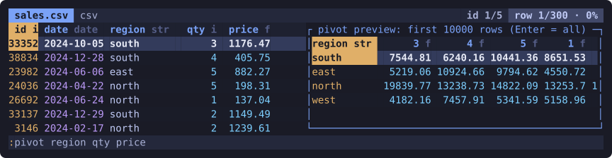

# visidata-rs

Modal terminal data explorer with VisiData's taste: Polars + Ratatui + mlua,
Lua-extensible like Neovim. Pre-alpha.



## Why

VisiData is open in one of my terminals most days. Treating everything as a
sheet, with a frequency table one keystroke away, changed how I look at data,
and nothing else in the terminal comes close. visidata-rs is not a fork. It
rebuilds that tool in Rust: same keys, same behavior (VisiData's own test corpus
is replayed against it), different insides.

The insides matter because that's where VisiData's open issues pile up:

- **Big files.** Rows are Python objects, read cell by cell; the maintainer
  says a real fix means changing the architecture
  ([#1068](https://github.com/saulpw/visidata/issues/1068)). Here Polars does
  the work: files are scanned lazily, only the visible window is loaded, and
  sorts, counts and pivots run off the UI thread.
- **curses.** The largest share of bug reports: resize crashes
  ([#1454](https://github.com/saulpw/visidata/issues/1454),
  [#2138](https://github.com/saulpw/visidata/issues/2138)), color pairs
  ([#3206](https://github.com/saulpw/visidata/issues/3206)), wide characters
  ([#2416](https://github.com/saulpw/visidata/issues/2416)). Ratatui and
  crossterm own the terminal here.
- **Plugins.** Plugins and `.visidatarc` patch live Python internals, so they
  break on upgrades ([#2084](https://github.com/saulpw/visidata/issues/2084),
  [#2142](https://github.com/saulpw/visidata/issues/2142)). Extensions here go
  through a fixed Lua API (loaders, aggregators, renderers, bindings), and
  `init.lua` reloads on save.
- **Python versions.** 3.12 broke expression eval
  ([#2179](https://github.com/saulpw/visidata/issues/2179)). A compiled binary
  doesn't care which Python you have. No prebuilt binaries yet, though:
  `cargo install` still compiles from source.

Two things are new rather than fixes:

- Your keystrokes build a Polars query plan. The plan panel shows it, and
  `:export` writes it out as a Polars or DuckDB script, so an exploratory
  session ends as code you can rerun.
- More vim, which is what VisiData users keep asking for
  ([#2500](https://github.com/saulpw/visidata/issues/2500),
  [#3008](https://github.com/saulpw/visidata/issues/3008)): ex commands with
  live preview now, macros and an undo tree next.

What it won't fix: VisiData's 60-odd loaders shrink to a core set plus Lua,
hundreds of commands are still hard to discover, and a Rust codebase doesn't
grow more maintainers. If VisiData does what you need, keep using it. I still do.

```text
cargo install --git https://github.com/neumann-mlucas/visidata-rs --locked   # installs `vdrs`; needs Rust 1.88+
vdrs data.parquet          # TUI
vdrs --headless data.csv   # schema + first rows, no TUI
cat data.csv | vdrs -      # stdin, format sniffed
```

The install compiles Polars with release optimizations: expect a long build (about
45 minutes in one test) and over 1 GB of disk while it runs.

Reads CSV, TSV, Parquet (file or directory), Arrow IPC, JSON Lines, JSON
arrays, Excel/ODS, SQLite (several sheets/tables → a list; `book.xlsx:Sheet2`
opens one) and DuckDB (through the `duckdb` program), and any of these gzipped; Lua loaders add more. Files are scanned
lazily: only a 1024-row window is materialized, and row counts, searches and
pivots run in the background.

Basics (VisiData's keys): `hjkl` move, `gg`/`G` top/bottom, `/` search the column (`g/` all), `[`/`]` sort, `gz|` filter,
`F` frequency table (`Enter` opens a value's rows), `I` describe, `W` pivot,
`s`/`gs`/`|`/`,` select (`z|` by SQL condition), `=` new column, `"` sheet of selected rows, `-` hide, `!` key column,
`#%~@` type casts, `e` edit, `a` add row, `d` delete row, `y`/`p` copy/paste (`Y`/`zP` system clipboard), `U`/`R` undo/redo (a tree: `:undotree`), `(`/`zM` expand structs / unfurl lists, `C` columns sheet (edits write back), `+` aggregators (`F` adds `Units_sum` …; `z+` in the status line), `b` sidebar, `S` sheet list, `:` ex
commands (`:join`, `:sql`, `:derive`, `:save out.parquet`, `:export view.sql`,
`:tail -f`, …), `q` back, `gq` quit, `Ctrl-c` cancels background work. `:pivot` previews its result while you type;
`:export` writes a Polars or DuckDB script that rebuilds the view, including
derived sheets.

- **User guide**: <https://neumann-mlucas.github.io/visidata-rs/>
- What ships: [`docs/specs/S-15-feature-inventory.md`](docs/specs/S-15-feature-inventory.md)
- Direction & scope: [`docs/direction.md`](docs/direction.md)
- Punchlist: [`docs/tasks.md`](docs/tasks.md)
- Planned: macros ([S-19](docs/specs/S-19-macros.md)). Edits
  ([S-18](docs/specs/S-18-editing-clipboard.md)) never touch the file you opened until `:save`
- Config: `$XDG_CONFIG_HOME/vdrs/init.lua`, hot-reloaded: `vd.bind` (to an action, ex
  command or Lua function), `vd.register_loader`, `vd.register_aggregator`,
  `vd.register_renderer`, `vd.set_theme` — see the guide's Lua section

Development: `cargo test` runs unit tests, end-to-end UI scenarios
(`app::scenario`) and, when a VisiData checkout sits at `../visidata`, its
golden-corpus replay (`tests/vd_replay.rs`; CI pins the commit). Without the
checkout that test skips.

## License

[GPL-3.0-or-later](LICENSE). Independent project, not affiliated with
[VisiData](https://github.com/saulpw/visidata).
